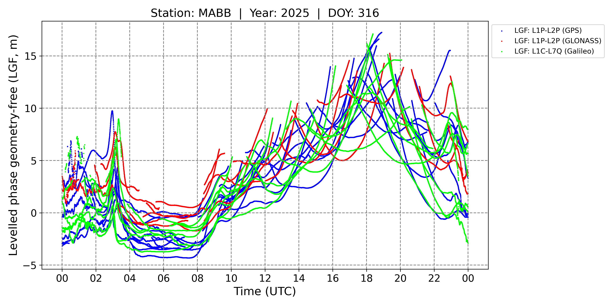
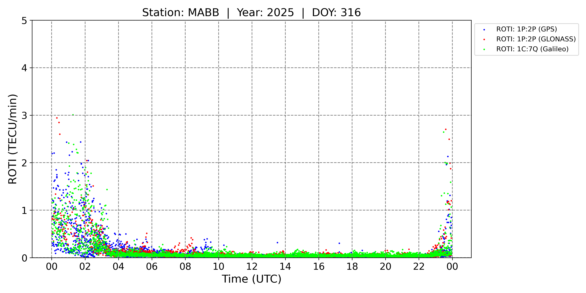
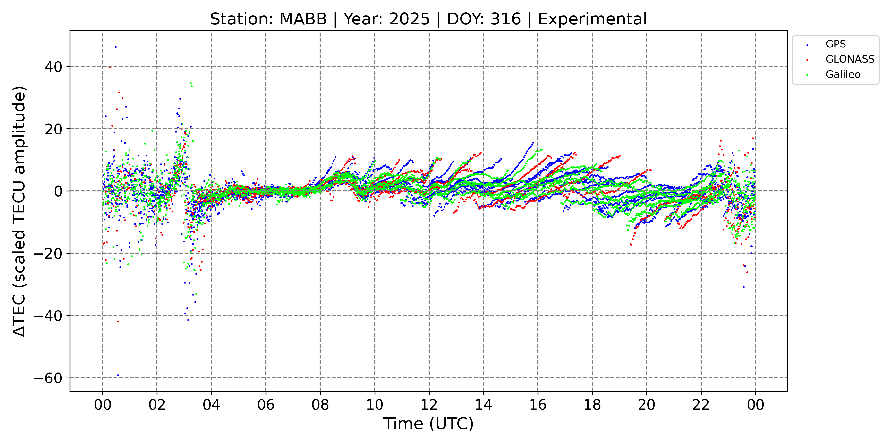
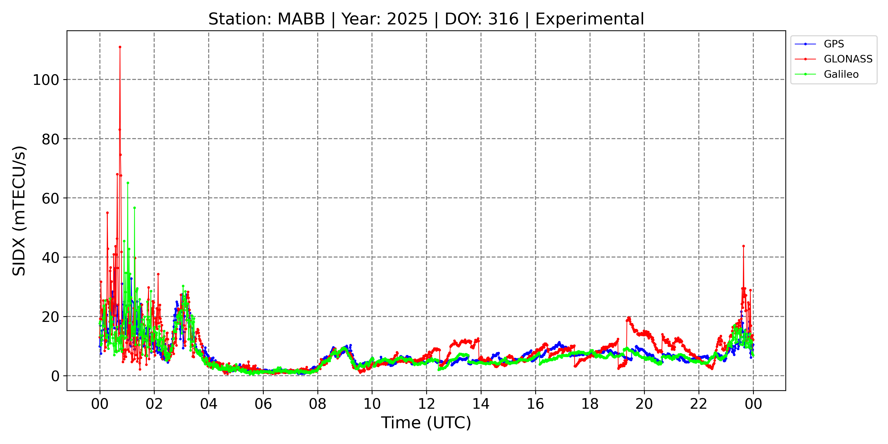
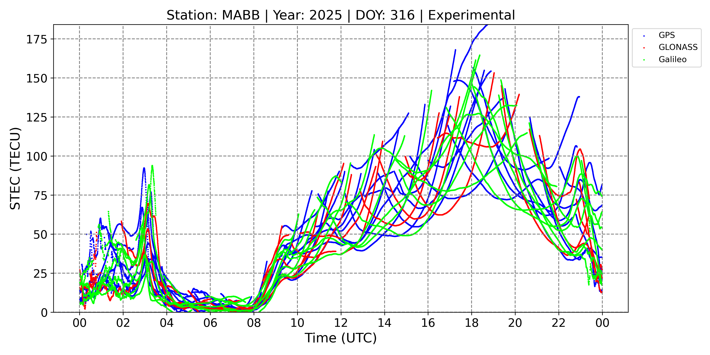
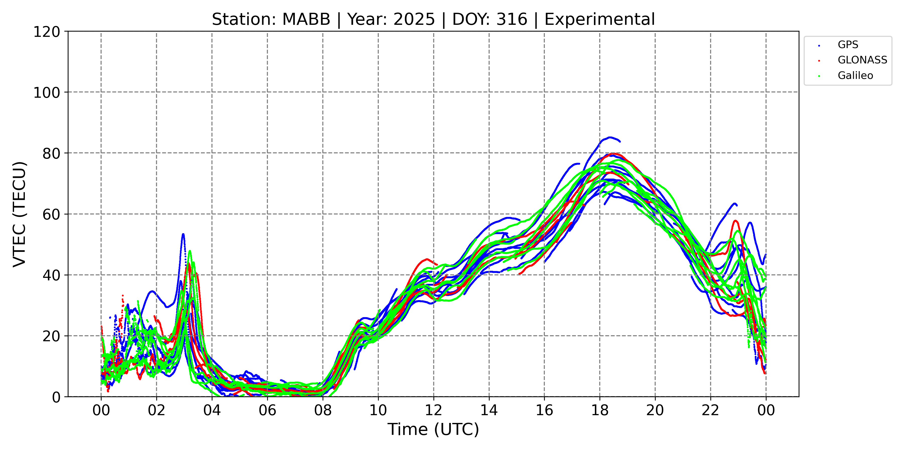
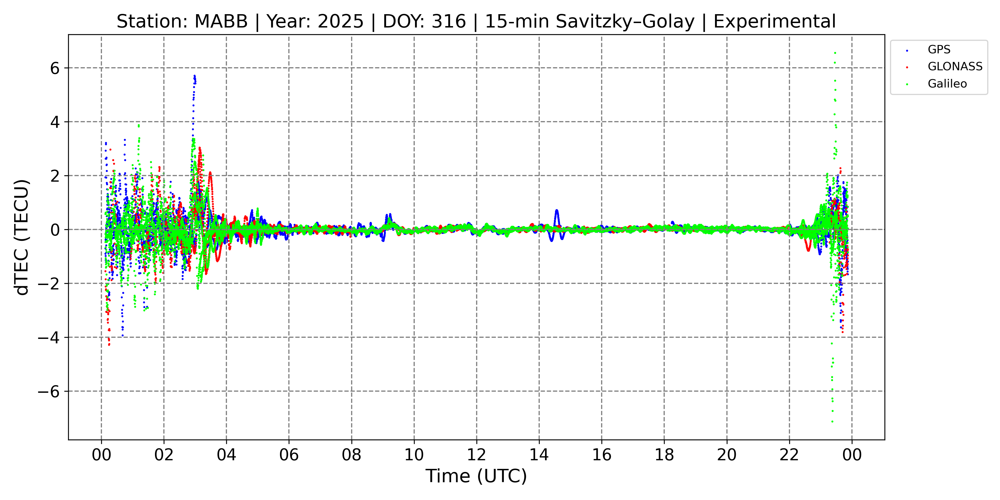
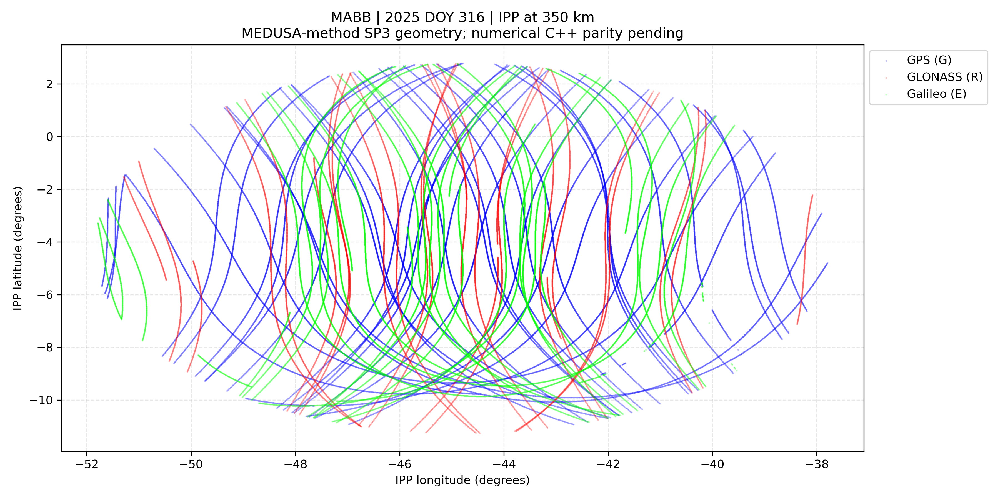

<p align="center">
  
</p>

# OASIS: Open-Access System for Ionospheric Studies

**pyOASIS 2.0.0 · Multi-GNSS ionospheric processing toolbox (beta)**

**OASIS** is a modular, open-access Python toolbox for processing multi-frequency GNSS data and computing ionospheric indices. It was developed to promote scientific transparency and reproducibility in ionospheric research.

OASIS provides a Python workflow for processing dual-frequency GNSS observations and deriving ionospheric products. Version 2.0 introduces a new processing API, native RINEX ingestion, integration with the MEDUSA historical quality-control engine, precise-orbit geometry, and consolidated HDF5 outputs. It is not API-compatible with the 1.x series.

---

## Key Features

- RINEX 2 and 3 observation processing; GPS, GLONASS, Galileo and BeiDou (subject to available signals and orbit coverage).
- RNX_QC: signal selection, outlier and cycle-slip screening, arc definition and geometry-free phase leveling through the integrated MEDUSA historical B111 runtime.
- SP3 orbit interpolation at signal transmission time, elevation, azimuth and ionospheric pierce points (350 km shell).
- Automatic orbit resolution with a local cache and optional NASA CDDIS download; Earthdata authentication may be required.
- Seven scientific products: LGF, ROTI, DELTATEC, SIDX, STEC, VTEC and detrended TEC (dTEC).
- Optional scientific figures and per-satellite QC diagnostics; Python API, command-line interface and batch examples.
- One HDF5 file per station/day; no intermediate RNX1/RNX2/RNX3 files or separate geometry audit/run-report files.

---

## Installation

For the published 2.0.0 distribution, install with:

```bash
python -m pip install pyOASIS==2.0.0
```

If version 2.0.0 is not yet available on PyPI, install from the updated source checkout as shown below.

Python 3.12 on Windows has been tested for the release candidate. The package metadata declares Python >=3.10; other Python versions and operating systems are not covered by this end-to-end test.

```bash
git clone https://github.com/giorgiopicanco/OASIS.git
cd OASIS
python -m venv .venv
```

Activate the environment (`.\.venv\Scripts\Activate.ps1` on Windows PowerShell, or `source .venv/bin/activate` on Unix-like systems), then run:

```bash
python -m pip install .
python -m pyOASIS --help
```

**Integrated runtime:** The historical MEDUSA processing components needed by OASIS are bundled in the package. No separate MEDUSA installation or service is required. Advanced users may supply a compatible external runtime with `--medusa-root` or `OASISConfig.medusa_root`.

---

## Installation Requirements

- Python 3.10 or higher (declared minimum; Python 3.12 tested).
- `numpy`, `scipy`, `pandas`, `h5py`, `matplotlib`, `requests`.

Install Python dependencies with `python -m pip install -r requirements.txt`.

---

## Example Input Data

The original repository provides example observation and orbit data for station BOAV, day 049 of 2023:

- `boav0491.23o` — RINEX observation file.
- `GFZ0MGXRAP_20230490000_01D_05M_ORB.SP3` — GFZ MGEX precise orbit file.

The examples below use `INPUT/RINEX/` and `INPUT/ORBITS/` as recommended subdirectories. Adjust these paths if your files are directly under `INPUT/`.

### Downloading MGEX Orbit Files (.SP3)

OASIS can resolve a matching orbit file from its local cache or download it when needed from the [NASA CDDIS archive](https://cddis.nasa.gov/archive/gnss/products/). An [Earthdata Login](https://urs.earthdata.nasa.gov/users/new) may be required. The automatic selection uses `GFZ0MGXRAP` from 2018 onward and `JAX0MGXFIN` for earlier dates, subject to archive availability. An explicit matching SP3 can also be supplied.

---

## Workflow Summary

1. **Input:** Read RINEX observations and resolve precise SP3 orbits.
2. **RNX_QC:** Select dual-frequency signals, screen outliers and cycle slips, define arcs and level geometry-free phase using the compatible MEDUSA runtime.
3. **Orbit Interpolation and IPP:** Compute satellite geometry at transmission time and IPPs on a 350 km shell.
4. **Index Derivation:** Compute ROTI, ΔTEC and SIDX from eligible observations.
5. **TEC Calibration:** Estimate experimental STEC and VTEC, then derive detrended VTEC (dTEC).
6. **Outputs:** Save consolidated HDF5 data and optional scientific figures.

---

## How to Run

Provide a daily RINEX observation file, and a matching SP3 orbit file (or a cache directory). The following command uses example paths; adjust them to your files. GPS-only processing avoids the need for an external GLONASS FDMA table.

```bash
python -m pyOASIS --rinex INPUT/RINEX/boav0491.23o --sp3 INPUT/ORBITS/GFZ0MGXRAP_20230490000_01D_05M_ORB.SP3 --systems G --products ALL --save-output hdf5 --figures --no-download --out OUTPUT
```

For multi-GNSS processing use `--systems GREC`. Only observed constellations with usable inputs can be processed; `--require-grec` enforces all four. GLONASS FDMA channels must be known for the observation epoch. A valid RINEX header takes precedence over the optional `--glonass-channels /path/to/channels.json` fallback. Do not use an unverified static table.

Omit `--sp3` and provide `--orbit-dir INPUT/ORBITS` to resolve matching orbits automatically. Use `--no-download` for offline runs; the default allows downloads if needed. Additional real SP3 files can be passed with `--supplemental-sp3`. Missing geometry is flagged rather than fabricated.

### Python API

```python
from pathlib import Path
from pyOASIS import OASISConfig, process

config = OASISConfig(
    rinex=Path('INPUT/RINEX/boav0491.23o'),
    orbit_dir=Path('INPUT/ORBITS'),
    output_dir=Path('OUTPUT'),
    systems='G',
    products=('ALL',),
    figures=True,
    figure_products=('LGF', 'ROTI', 'DELTATEC', 'SIDX', 'STEC', 'VTEC', 'dTEC', 'IPP'),
    plot_min_elevation=20.0,
    product_figure_color_mode='constellation',
    mean_line=False,
    offline=True,
    overwrite_output=False,
)
result = process(config)
```

The repository also contains `main.py`, `main_sequential.py`, `main_rbmc_rinex2.py` and `examples/process_day.py`. Edit the input paths, dates, orbit cache and GLONASS table as appropriate before running. The RBMC batch example skips stations with existing HDF5 outputs when overwrite is disabled, reports per-station failures and continues processing. A specific insufficient-observations OFFSET error rejects the affected QC segment instead of terminating the entire station; unrelated exceptions remain visible.

---

## Scientific Products

| Key | Description |
| --- | --- |
| LGF | Carrier-phase geometry-free combination, corrected and leveled to code by accepted arcs. |
| ROTI | Population standard deviation of ROT in fixed UTC 150-second MEDUSA ION V6 windows, with QC and continuity screening. |
| DELTATEC | Legacy OASIS ΔTEC index: scaled short/long rolling-mean difference within 150-second windows. It is a scaled TEC amplitude, not a physical time derivative. |
| SIDX | Mean absolute ROT in 60-second windows; constellation-level plots use mTECU/s. |
| STEC | Experimental model-calibrated slant TEC with per-arc offsets. |
| VTEC | Experimental vertical TEC from the same model and mapping geometry. |
| DTEC | dTEC: VTEC minus a centered linear Savitzky–Golay background (nominal 15 minutes), confined to eligible contiguous QC segments. |

The older DTEC name referred to the legacy ΔTEC index; in schema 2.1 that index is DELTATEC and DTEC denotes detrended VTEC. Use algorithm metadata when reading older files. The code uses selected signal frequencies, including GLONASS FDMA, rather than a universal GPS conversion factor.

---

## Directory Structure

```text
OASIS/
├── main.py                  # Single-file processing
├── main_sequential.py       # Sequential processing
├── main_rbmc_rinex2.py       # RBMC batch example
├── pyOASIS/
│   ├── api.py               # Public Python API
│   ├── cli.py               # Command-line interface
│   ├── gnss/                # QC adapters, orbits and ionospheric products
│   ├── rinex/               # RINEX reader and signal selection
│   ├── io/                  # HDF5 export
│   ├── visualization/       # Scientific figures
│   └── _vendor/medusa/      # Integrated historical QC runtime
├── examples/
├── docs/
├── tests/
├── INPUT/
└── img/
```

The integrated MEDUSA historical runtime is located under `pyOASIS/_vendor/medusa/`.

---

## Outputs and Figures

```
OUTPUT/BOAV/2023/049/
    BOAV_2023_049_ION.h5
    BOAV_049_2023_LGF.png
    BOAV_049_2023_ROTI.png
    BOAV_049_2023_deltaTEC.png
    BOAV_049_2023_SIDX.png
    BOAV_049_2023_STEC.png
    BOAV_049_2023_VTEC.png
    BOAV_049_2023_dTEC.png
    BOAV_049_2023_IPP_350KM.png
```

The folder date follows the nominal RINEX GPST day; plot time and index windows are UTC. Products with no eligible observations may have no figure. The HDF5 contains scientific arrays, QC flags, arc information, geometry and provenance. Existing HDF5 files are protected unless `--overwrite-output` is supplied. Existing figures are not automatically deleted. `--save-output none` disables HDF5 writing. A compact result is printed to the console.

- `--products ALL`: compute all seven products. `--figure-products LGF,ROTI,dTEC` selects plots independently of computation.
- `--figures`: enable overview figures. `--qc-figures`: opt in to per-satellite diagnostics; `--no-overview-figures` allows QC-only output.
- `--plot-min-elevation 20`: display elevation threshold; existing scientific eligibility cutoffs still apply.
- `--product-figure-color-mode constellation`: GPS blue, GLONASS red, Galileo lime, BeiDou violet. `blue_red` uses blue satellite values and red station mean where applicable. SIDX retains its original constellation curves; QC and IPP styles are unchanged.
- Station mean lines are optional and limited to VTEC, DELTATEC and DTEC. `--no-mean-line` disables them; `--mean-min-satellites 4` sets minimum support. No additional station-mean smoothing is plotted.
- ROTI display range is 0–5 TECU/min. STEC and VTEC display from zero to at least 120 TECU, expanding for larger visible values. These are plotting limits, not scientific rejection thresholds.

To replot a supported HDF5 without rereading RINEX:

```bash
python -m pyOASIS plot-hdf5 --input OUTPUT/BOAV/2023/049/BOAV_2023_049_ION.h5 --figure-products LGF,dTEC
python -m pyOASIS inspect-hdf5 --input OUTPUT/BOAV/2023/049/BOAV_2023_049_ION.h5
```

---

## Scientific Examples

The following figures illustrate OASIS 2.0.0 processing for station MABB, Brazil, on November 12, 2025 (DOY 316), during the severe geomagnetic storm. Constellations are identified by the legends in the figures.

### Geometry-Free Leveling (LGF)

<p align="center">
  
</p>

*Arc-wise leveled geometry-free carrier-phase combinations after RNX_QC.*

---

### Rate of TEC Index (ROTI)

<p align="center">
  
</p>

*ROTI calculated over fixed 150-second windows.*

---

### TEC Anomaly Index (ΔTEC)

<p align="center">
  
</p>

*Legacy OASIS scaled short/long rolling-mean difference within 150-second windows.*

---

### Sudden Ionospheric Disturbance Index (SIDX)

<p align="center">
  
</p>

*Mean absolute ROT over 60-second windows, displayed by constellation.*

---

### Slant Total Electron Content (STEC)

<p align="center">
  
</p>

*Experimental model-calibrated slant TEC along satellite-receiver paths.*

---

### Vertical Total Electron Content (VTEC)

<p align="center">
  
</p>

*Experimental vertical TEC obtained using thin-shell mapping; absolute calibration requires independent validation.*

---

### Detrended TEC (dTEC)

<p align="center">
  
</p>

*Experimental detrended VTEC after removal of a centered 15-minute Savitzky–Golay background.*

---

### Ionospheric Pierce Points (IPP)

<p align="center">
  
</p>

*Satellite-receiver ionospheric pierce-point trajectories computed on a 350 km shell.*

---

## Validation and Limitations

The release candidate passed 55 automated regression tests in the development checkout. The wheel and source distribution were built and passed Twine checks. A separate Python 3.12 environment successfully installed the wheel and processed BOAV RINEX 2 (2023, day 049, GPS only) using an external MEDUSA runtime and matching SP3. The run completed in 76.32 seconds with 32 satellites, 5,700 epochs, 62,336 LGF samples, 62,334 valid IPPs, all seven products and eight overview figures.

| Product | Records in BOAV integration test |
| --- | ---: |
| LGF | 62,336 |
| ROTI | 5,877 |
| DELTATEC | 6,099 |
| SIDX | 15,496 |
| STEC | 40,043 |
| VTEC | 40,043 |
| DTEC | 20,750 |

The run completed with warnings: 3,731 negative model STEC estimates were preserved and flagged as nonphysical. Absolute STEC/VTEC calibration and dTEC scientific interpretation require independent validation. A successful integration test is not evidence of absolute TEC accuracy. Compiled MEDUSA/RTKLIB geometry parity and historical versus live MEDUSA QC context parity also remain to be independently established. The GPS-only wheel test does not establish end-to-end performance for every constellation or dataset. An additional development-checkout integration test using the bundled runtime (without `--medusa-root`) reproduced all seven BOAV product record counts and the same STEC warning. The integrated checkout passed 57 regression tests, including two tests of automatic runtime resolution and QC imports.

Run regression tests from the source checkout with `python -m unittest discover -s tests -v` . Historical methodology notes in `docs/` describe earlier stages; current output conventions are documented above.

---

## Cite This Work

If you use OASIS in your research, please cite the software and the original scientific work. See [`CITATION.cff`](CITATION.cff) for the repository citation metadata.

<details>
<summary><strong>APA — original manuscript</strong></summary>

Picanço, G. A. S., Fagundes, P. R., Prol, F. S., Denardini, C. M., Mendoza, L. P. O., Pillat, V. G., Rodrigues, I., Christovam, A. L., Meza, A. M., Natali, M. P., Romero-Hernández, E., Aguirre-Gutierrez, R., Agyei-Yeboah, E., & Muella, M. T. A. H. (2025). *Introducing OASIS: An Open-Access System for Ionospheric Studies*.

</details>

<details>
<summary><strong>ABNT — original manuscript</strong></summary>

PICANÇO, G. A. S.; FAGUNDES, P. R.; PROL, F. S.; DENARDINI, C. M.; MENDOZA, L. P. O.; PILLAT, V. G.; RODRIGUES, I.; CHRISTOVAM, A. L.; MEZA, A. M.; NATALI, M. P.; ROMERO-HERNÁNDEZ, E.; AGUIRRE-GUTIERREZ, R.; AGYEI-YEBOAH, E.; MUELLA, M. T. A. H. *Introducing OASIS: An Open-Access System for Ionospheric Studies*. 2025.

</details>

<details>
<summary><strong>GitHub Repository — software</strong></summary>

Picanço, G. A. S. (2026). *OASIS: Open-Access System for Ionospheric Studies* (Version 2.0.0, release candidate) [Software]. GitHub. https://github.com/giorgiopicanco/OASIS

</details>

The original manuscript citation is retained from the historical README; its current publication status is not established here.

---

## Acknowledgments

OASIS incorporates historical processing components from MEDUSA. The package does not require the Bernese GNSS Software executable or a Bernese installation. The original MEDUSA source provenance and references to Bernese-compatible and ported routines are retained; see [THIRD_PARTY_NOTICES.md](THIRD_PARTY_NOTICES.md).

---

## Contact

Developed by Giorgio Picanço (Ph.D. in Space Geophysics).

For questions or contributions, visit [the GitHub repository](https://github.com/giorgiopicanco/OASIS) or email giorgiopicanco@gmail.com.

---

## License

OASIS is distributed under [CC BY-NC 4.0](https://creativecommons.org/licenses/by-nc/4.0/) for noncommercial use, subject to the applicable terms. See `LICENSE`.
